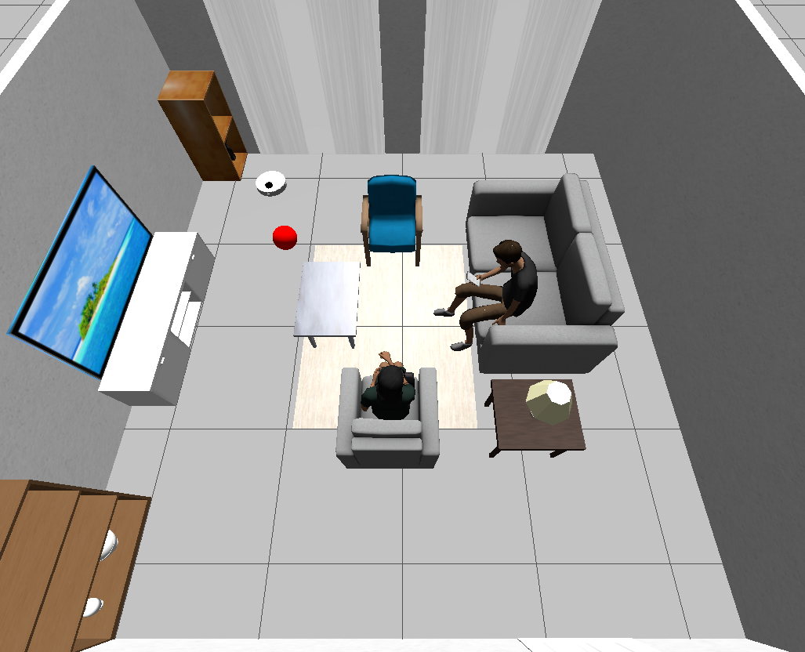
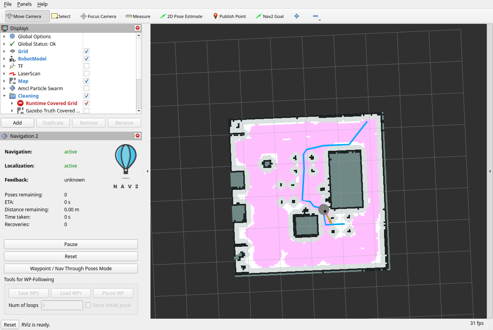
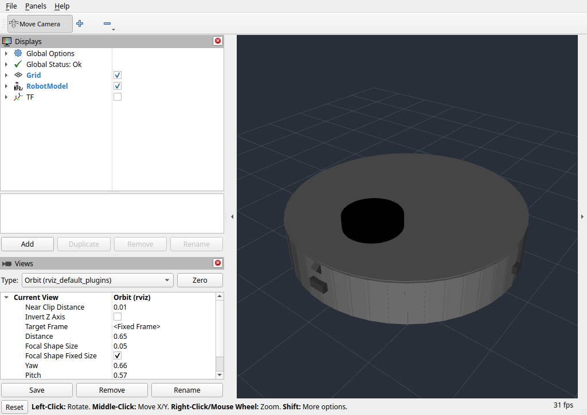
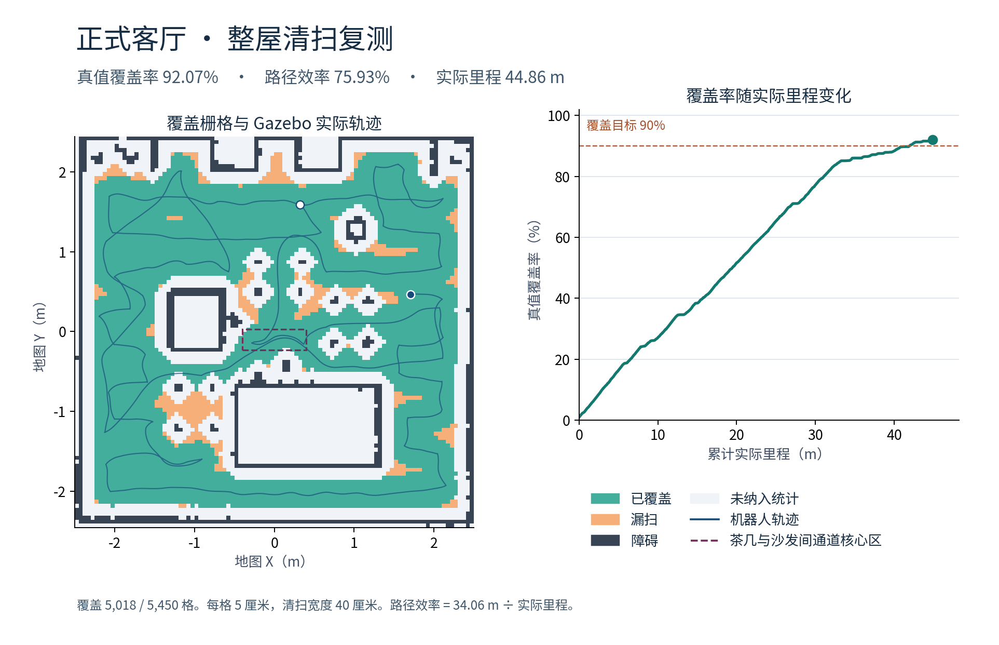
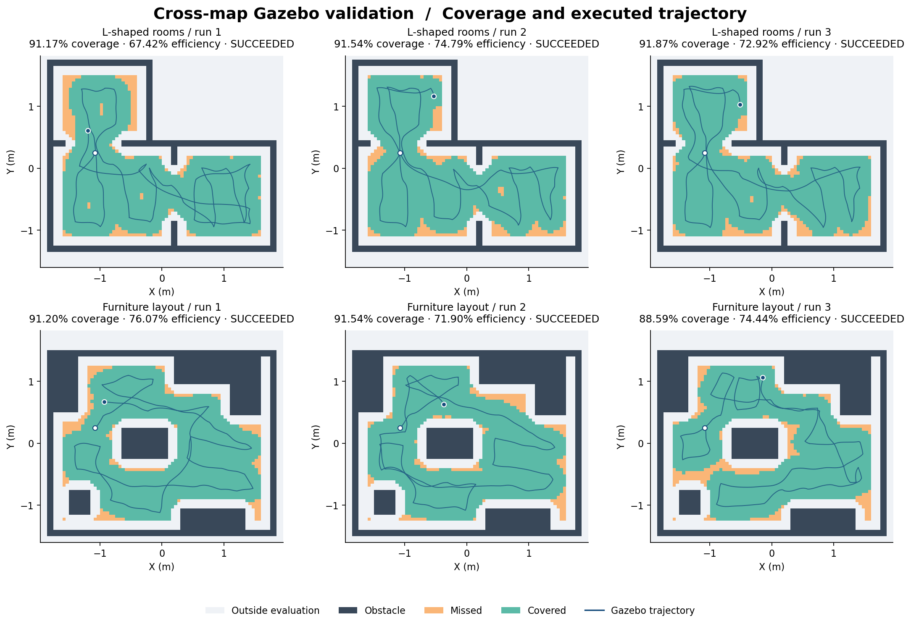
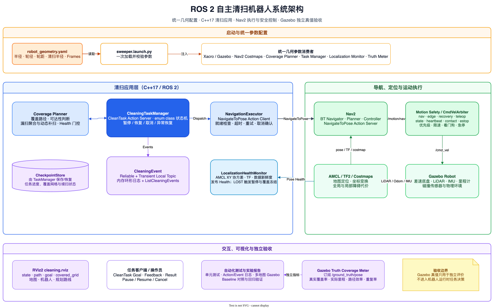

# ROS 2 自主清扫机器人


> 这是我为机器人软件开发岗位准备的简历项目。目标不只是让机器人“能动”，而是让它能够自主生成清扫路线、执行清扫任务、识别漏扫区域，并在导航失败或遇到障碍时继续完成任务。

## 可视化效果


演示包含 Gazebo 物理仿真、RViz2 导航与定位、覆盖路径执行以及独立真值验收。

### Gazebo 正式客厅



Gazebo 用于验证机器人运动学、激光雷达、碰撞、家具绕行和动态障碍。正式客厅包含沙发、茶几、座椅、电视柜等典型室内障碍。

### RViz2 专用清扫界面



专用界面默认显示栅格地图、机器人模型、运行时覆盖网格、清扫规划路线、任务执行路线、当前目标以及 Nav2 状态。粉色区域表示已覆盖区域，蓝色折线表示当前任务路线。

项目提供专用的 `cleaning.rviz` 配置。使用 `rviz:=true` 启动时会自动加载该界面；TF、激光点、AMCL 粒子以及 Nav2 全局/局部代价地图默认关闭，需要排查问题时可手动开启。Gazebo 真值覆盖图层同样默认关闭，需要独立验收时可在 RViz 的 `Cleaning` 分组中开启。

| RViz2 机器人模型 | 整屋覆盖与真实轨迹 |
|---|---|
|  |  |

左图用于检查 URDF、关节和 TF；右图根据 Gazebo 真实位姿展示已覆盖区域、漏扫区域、机器人轨迹以及覆盖率随实际里程的变化。

### 跨地图覆盖验收



该图保留 L 形多房间和复杂家具布局的六轮零调参测试结果，包括未达到 90% 的样本，用于分析跨地图泛化能力，而不是只展示最好的一次运行。

## 项目实现的功能

- 根据栅格地图自动生成覆盖清扫路线。
- 通过 Nav2 `NavigateToPose` Action 执行清扫航点。
- 根据 TF 位姿更新已清扫区域，识别漏扫并动态补扫。
- 支持任务暂停、恢复、取消和检查点续扫。
- 处理导航失败、超时、Nav2 退出和动态障碍。
- 对导航、手动控制、恢复和急停速度指令进行安全仲裁。
- 使用 Gazebo 真值轨迹独立统计覆盖率、实际里程和路径效率。
- 统一管理机器人半径、轮径、轮距、清扫半径和关键坐标系。
- 监控 AMCL 协方差与 TF 健康状态，定位异常时暂停任务和覆盖统计。
- 发布结构化清扫事件，并支持按任务和事件代码查询历史记录。

## 核心开发内容

项目围绕室内移动机器人自主清扫场景完成了从仿真、导航到任务管理和工程验收的完整链路：

1. 使用 C++17 和 ROS 2 Action 实现清扫任务管理器。
2. 实现覆盖路径规划、漏扫识别和动态补扫。
3. 用 `enum class` 重构任务状态机，统一管理状态转换。
4. 处理任务取消与导航结果竞争、旧任务回调延迟到达等异步问题。
5. 实现速度指令仲裁、急停、碰撞停车和心跳看门狗。
6. 建立统一机器人几何配置，并验证 URDF、Gazebo、Nav2 和清扫模块的一致性。
7. 实现定位健康监控、定位异常暂停以及稳定恢复后的安全续扫。
8. 实现结构化任务事件日志，记录状态转换、规划、导航、恢复和任务结果。
9. 搭建 Gazebo 自动化测试，并增加简单弓字形 baseline 进行算法对照。

## 为什么适合作为机器人软开项目

这个项目覆盖了移动机器人软件从感知定位、任务决策、路径执行、安全控制到仿真验收的完整链路，能够集中展示 ROS 2 应用开发、C++ 工程设计、导航算法集成和系统可靠性处理能力。

| 岗位常见能力 | 项目中的实际实现 | 可以说明的工程问题 |
|---|---|---|
| C++ 与 ROS 2 开发 | 使用 C++17 实现清扫管理、覆盖规划、导航调度、定位监控和速度安全节点，通过 Topic、Service、Action 及 TF2 组织通信 | 如何划分节点职责、设计接口、配置 QoS，并管理异步回调 |
| 长任务与异步状态管理 | 使用 `CleanTask` Action、类型安全状态机和任务代次管理暂停、恢复、取消及检查点续扫 | 如何处理取消与导航完成竞争、旧回调晚到和任务生命周期一致性 |
| 地图与导航算法 | 基于 OccupancyGrid、机器人净空和清扫宽度生成覆盖路线，根据实时覆盖状态识别漏扫并动态补扫 | 如何进行坐标转换、可达性判断，并权衡覆盖率、绕行与重复清扫 |
| Nav2 系统集成 | 对接 AMCL、TF2、Nav2 `NavigateToPose`、全局/局部代价地图和行为树导航 | 如何判断导航系统就绪、处理目标失败与超时，并将规划结果可靠地交给执行层 |
| 可靠性与安全 | 实现定位健康监控、速度指令仲裁、急停、碰撞停车、心跳看门狗和异常恢复 | 为什么定位异常时必须冻结覆盖统计，以及如何保证异常状态下机器人安全停止 |
| 仿真测试与数据验证 | 使用 Gazebo 多场景测试、Gazebo 真值轨迹独立验收、单元测试和 baseline 对照实验 | 如何区分规划路径、运行时估算和真实执行结果，并用可复现数据分析算法效果 |

这些内容与 ROS 2 机器人软件开发、AMR 导航应用、机器人系统集成及仿真测试岗位的日常工作具有直接对应关系。面试时可以从一次清扫任务的完整调用链出发，继续深入到状态机、导航异常、定位跳变、动态补扫或测试评价方法，既能展示系统全貌，也能讨论具体源码设计。

## 项目架构



系统分为启动配置、清扫应用、导航与运动执行、交互与独立验收四个部分：

```text
robot_geometry.yaml -> sweeper.launch.py
        -> Xacro / Gazebo + Nav2 Costmaps + 清扫节点 + 真值评估器

CleanTask Action -> CleaningTaskManager <-> Coverage Planner
                         ├── NavigationExecutor -> Nav2 -> Motion Safety -> Gazebo Robot
                         ├── CheckpointStore
                         └── CleaningEvent

AMCL / TF / Odom -> LocalizationHealthMonitor
                         └── Manager 暂停任务 / Planner 冻结覆盖统计

Gazebo ground truth -> Coverage Meter -> 自动化测试与实验报告
                       （不参与运行时任务决策）
```

- `robot_geometry.yaml`：机器人半径、轮径、轮距、清扫半径和关键坐标系的唯一来源，由 Bringup 注入 Xacro、Gazebo、Nav2、清扫节点和真值评估器。
- `CleaningTaskManager`：任务的统一协调入口。
- `Coverage Planner`：生成初始清扫路线和补扫路线。
- `NavigationExecutor`：向 Nav2 发送航点并处理导航结果。
- `LocalizationHealthMonitor`：根据 AMCL 协方差、TF 和数据新鲜度判断定位状态。
- `CheckpointStore`：保存任务进度、覆盖网格和续扫状态。
- `Motion Safety`：管理速度指令优先级和安全停车。
- `CleaningEvent`：通过可靠、Transient Local Topic 和查询服务记录任务生命周期与异常恢复事件。
- `Coverage Meter`：根据 Gazebo 真值位姿独立统计覆盖率、实际里程、路径效率和重复行驶率，只用于验收。

## 项目目录

```text
.
├── ros2_ws/
│   └── src/
│       ├── robot_cleaning_interfaces/   # CleanTask Action、定位健康与事件接口
│       ├── robot_cleaning_manager/      # 任务状态机、Nav2 调度、恢复与检查点
│       ├── robot_coverage_planner/      # 覆盖规划、漏扫识别与动态补扫
│       ├── robot_motion_safety/         # 速度仲裁、急停、碰撞与看门狗
│       ├── robot_sweeper_bringup/       # Gazebo、Nav2、RViz2 一体化启动
│       └── upstream/                    # 机器人模型、仿真世界和基础导航支持
├── scripts/                             # 场景生成、自动测试和验收脚本
├── docs/
│   ├── assets/                          # 架构图、GIF 和仿真截图
│   └── refactor_and_baseline.md         # 重构与基线实验说明
├── results/                             # 已筛选提交的基线数据与验收报告
└── README.md
```

五个清扫应用包通过 ROS 2 Topic、Service 和 Action 解耦；`robot_sweeper_bringup` 负责把机器人模型、Gazebo、定位、Nav2、清扫应用层和 RViz2 组合成完整系统。

## 面试中可以重点介绍的内容

### 1. ROS 2 Action 与任务状态机

清扫任务执行时间长，需要持续反馈进度，还需要支持取消，因此使用 Action 而不是 Service。状态机负责约束 `PLANNING`、`RUNNING`、`PAUSED`、`RECOVERING` 等状态之间的转换。

为了防止旧任务的导航或规划回调改变新任务，系统对任务和导航请求都进行代次校验。

### 2. 覆盖规划与动态补扫

初始路线根据地图可达区域、机器人净空和清扫宽度生成。任务执行过程中，系统根据 TF 位姿更新覆盖网格，将剩余漏扫区域聚合，再结合可达性、覆盖收益和行驶代价生成补扫路线。

### 3. 定位异常为什么必须暂停覆盖统计

如果定位发生跳变，继续更新覆盖网格会把机器人没有经过的区域错误标记为已清扫。定位监控器通过 AMCL XY 协方差、`map -> base_footprint` TF 和运动时的数据新鲜度判断健康状态。

定位丢失后，系统取消当前 Nav2 目标、停止恢复速度、保存检查点并冻结覆盖率和里程；只有定位稳定恢复、Nav2 可用且急停解除后，定位监控触发的暂停才会自动续扫。人工暂停不会被自动恢复。

### 4. 怎么证明算法有效

项目不使用规划路线代替真实执行轨迹，而是使用 Gazebo 真值位姿独立计算覆盖率和行驶里程。同时实现了一套独立的简单弓字形 baseline，使用相同地图、Nav2 参数和验收方式与当前算法对比。

## 仿真结果

### 代码与回归测试

- 7 个相关 ROS 2 包构建成功。
- `260 tests, 0 errors, 0 failures, 11 skipped`。
- 已验证暂停恢复、取消、检查点续扫、导航失败、Nav2 退出和动态障碍恢复。
- 定位丢失后，覆盖率和执行里程保持冻结；稳定恢复后仅自动恢复定位触发的暂停。
- 导航异常测试中，Nav2 关闭后约 `0.375 s` 内速度归零，清扫 Action 正确返回失败原因。
- 结构化事件查询验证了任务 ID 过滤、事件代码过滤、容量淘汰和最新事件优先顺序。

### 优化算法与 baseline

| 五张地图平均 | 当前算法 | baseline |
|---|---:|---:|
| Gazebo 真值覆盖率 | 91.68% | 91.20% |
| 实际行驶里程 | 15.55 m | 20.09 m |
| 到达 90% 覆盖的里程 | 14.49 m | 17.96 m |
| 路径效率 | 74.51% | 56.61% |
| 重复行驶率 | 25.63% | 39.55% |

- 10/10 轮 Action 执行成功，10/10 轮 Gazebo 真值覆盖率达到 90%。
- 当前算法平均少行驶 4.54 m，路径效率提高 17.90 个百分点。
- L 形地图中 baseline 反而少行驶 0.60 m，说明跨区域顺序仍有优化空间。

动态障碍测试中，障碍物位姿更新 62 次，发生 1 次导航失败并恢复，最终 Action 成功，Gazebo 真值覆盖率为 91.54%。

最新专项回归再次记录了 62 次动态障碍更新、2 次碰撞恢复和 1 次导航失败，任务最终成功。该轮执行的是分区清扫，因此运行时分区覆盖率不能与整图真值覆盖率直接比较。

[查看完整 baseline 对照数据](results/refactor-baseline-20261113/experiments/comparison.md)

## 技术栈

- C++17、Python 3、CMake、colcon、GTest
- ROS 2 Jazzy、`rclcpp`、Action、Service、Topic、TF2、Lifecycle
- Nav2、AMCL、SLAM Toolbox、costmap
- Gazebo Harmonic、`ros_gz_bridge`
- Reliable / Transient Local QoS、结构化事件接口、异步回调代次保护
- 栅格地图、弓字形覆盖、Wavefront 连接、可达性检查

## 环境与构建

### 1. 环境要求

- Ubuntu 24.04
- ROS 2 Jazzy Desktop
- Nav2、SLAM Toolbox
- Gazebo Harmonic 与 `ros_gz`
- Python 3、CMake、colcon

克隆项目：

```bash
git clone https://github.com/xubenshan/ros2_sweeper.git
cd ros2_sweeper
```

首次使用时安装依赖：

```bash
sudo apt update
sudo apt install -y python3-rosdep python3-colcon-common-extensions

source /opt/ros/jazzy/setup.bash
sudo rosdep init        # 系统已经初始化过 rosdep 时跳过这一行
rosdep update
rosdep install --from-paths ros2_ws/src --ignore-src -r -y
```

### 2. 编译

```bash
cd ros2_ws
source /opt/ros/jazzy/setup.bash

colcon build --symlink-install --parallel-workers 3
source install/setup.bash
```

后续打开新终端时，需要重新加载环境：

```bash
cd <项目目录>/ros2_ws
source /opt/ros/jazzy/setup.bash
source install/setup.bash
```

### 3. 单元测试

```bash
cd <项目目录>/ros2_ws
source /opt/ros/jazzy/setup.bash
source install/setup.bash

colcon test
colcon test-result --all --verbose
```

当前回归结果为 `260 tests, 0 errors, 0 failures, 11 skipped`。

## 运行与查看清扫效果

### 方式一：Gazebo、RViz2 和真值评估同时启动

终端一：

```bash
cd <项目目录>/ros2_ws
source /opt/ros/jazzy/setup.bash
source install/setup.bash

ros2 launch robot_sweeper_bringup sweeper.launch.py \
  implementation:=cpp \
  mode:=localize \
  gui:=true \
  rviz:=true \
  evaluate:=true \
  open_floor:=true
```

等待 Gazebo、AMCL 和 Nav2 完成启动后，在终端二发送整屋清扫任务：

```bash
cd <项目目录>/ros2_ws
source /opt/ros/jazzy/setup.bash
source install/setup.bash

ros2 action send_goal --feedback \
  /cleaning/task \
  robot_cleaning_interfaces/action/CleanTask \
  "{task_id: 'living-room-demo', mode: 0, regions: [], target_coverage: 0.90, resume_checkpoint: false}"
```

RViz2 会自动加载专用的 `cleaning.rviz`：

- 绿色：覆盖规划路径 `/cleaning/planner_path`
- 蓝色：当前任务路线 `/cleaning/path`
- 橙色：当前清扫目标 `/cleaning/current_goal`
- 覆盖图层：`/cleaning/covered_grid`
- Gazebo 真值覆盖图层：`/coverage_meter/covered_grid`，默认关闭

### 方式二：自动运行并保存验收结果

```bash
cd <项目目录>
source /opt/ros/jazzy/setup.bash
source ros2_ws/install/setup.bash

python3 scripts/run_cleaning_benchmark.py \
  --scenario living_room \
  --runs 1 \
  --whole-map \
  --gui \
  --timeout 900 \
  --coverage-algorithm optimized \
  --output results/manual-living-room
```

运行结束后查看：

```text
results/manual-living-room/living_room/run-1/result.json
results/manual-living-room/summary.csv
```

其他内置场景可将 `--scenario` 改为：

| 场景 | 参数 | 主要验证内容 |
|---|---|---|
| 双房间 | `multi_room` | 跨房间连接与区域访问顺序 |
| 岛状障碍 | `islands` | 障碍物周围覆盖与补扫 |
| 窄通道 | `narrow` | 狭窄区域通行与重复行驶 |
| 动态障碍 | `dynamic` | 障碍变化、导航恢复与重新规划 |

### 实时查看任务指标

```bash
# 清扫任务状态与运行时进度
ros2 topic echo /cleaning/state
ros2 topic echo /cleaning/progress

# Gazebo 独立真值指标，需要 evaluate:=true
ros2 topic echo /coverage_meter/ratio
ros2 topic echo /coverage_meter/efficiency
ros2 topic echo /coverage_meter/revisit_ratio
```

## 关键配置与接口

- 机器人几何唯一配置：`robot_geometry.yaml`
- 清扫任务 Action：`robot_cleaning_interfaces/action/CleanTask`
- 定位健康消息：`robot_cleaning_interfaces/msg/LocalizationHealth`
- 清扫事件消息与查询：`CleaningEvent.msg`、`ListCleaningEvents.srv`

## 详细文档

- [任务管理器重构与 baseline 设计](docs/refactor_and_baseline.md)
- [完整验收报告](results/refactor-baseline-20261113/report.md)
- [优化算法与 baseline 逐场景数据](results/refactor-baseline-20261113/experiments/comparison.md)
