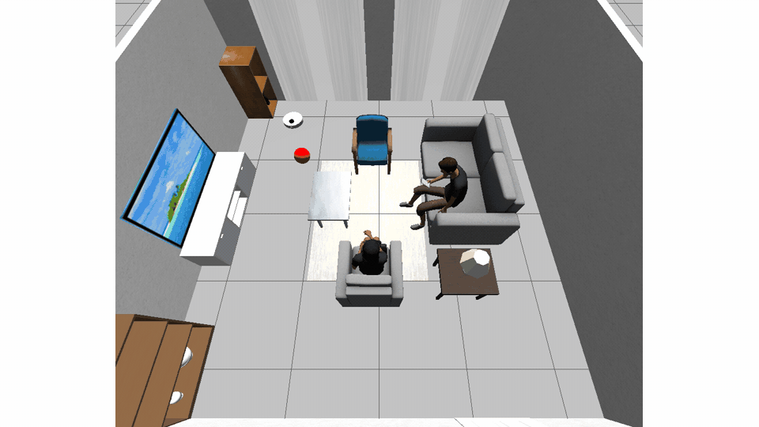

# ROS 2 室内扫地机器人自主导航与覆盖清扫系统


一个面向室内清扫业务的 ROS 2 C++ 项目：从栅格地图生成覆盖路线，通过 Nav2 完成航点执行，在运行中识别漏扫并动态补扫，由 `CleanTask` Action 统一管理任务生命周期，最后使用 Gazebo 真值轨迹独立验收。

> 项目基于 [makerspet/oomwoo](https://github.com/makerspet/oomwoo) 的机器人模型、Gazebo 场景与基础 ROS 组件进行二次开发。个人实现与重构的重点是清扫应用层：任务管理、状态机、覆盖规划、动态补扫、速度安全仲裁和自动化验收。

## 演示预览



GIF 由本项目的真实 Gazebo 客厅、RViz 机器人模型、整屋覆盖图和跨地图验收图组成，不是概念效果图。

## 核心能力

| 能力 | 实现 |
|---|---|
| 清扫任务管理 | C++17、`rclcpp_action`、`CleanTask` Action，支持暂停、恢复、取消和检查点续扫 |
| 类型安全状态机 | `enum class TaskState` + 合法转换表，防止多异步回调任意改写状态 |
| 覆盖路径规划 | 基于可达栅格生成覆盖条带，搜索扫掠方向和相位，优化区域与条带访问顺序 |
| 动态漏扫补偿 | 根据 TF 实时更新覆盖栅格，聚合未覆盖区域，结合可达性、覆盖收益和行驶代价生成补扫路线 |
| Nav2 集成 | `NavigateToPose` Action 航点调度，处理超时、失败、取消竞争和过期回调 |
| 运动安全 | 对导航、手动控制、异常恢复和急停指令进行优先级仲裁，包含心跳看门狗和碰撞停车 |
| 独立工程验收 | 使用 Gazebo 真值位姿统计覆盖率、真实里程、到 90% 里程、路径效率和重复行驶率 |

## 系统架构


架构图是内嵌 draw.io 源数据的 SVG，可直接使用 draw.io 打开继续编辑。

### 模块边界

| ROS 2 包 | 职责 |
|---|---|
| `robot_cleaning_interfaces` | `CleanTask` Action、覆盖规划 Service 及清扫消息定义 |
| `robot_cleaning_manager` | Action Server、任务状态机、规划请求、Nav2 调度、检查点、异常恢复 |
| `robot_coverage_planner` | 优化覆盖规划、独立弓字形基线、动态补扫和运行时覆盖统计 |
| `robot_motion_safety` | `cmd_vel` 指令仲裁、急停、碰撞停车和超时保护 |
| `robot_sweeper_bringup` | Gazebo、Nav2、ROS-Gazebo 桥接、清扫节点和参数的统一启动 |
| `upstream/oomwoo_ws` | 上游 OOMWOO 机器人模型、仿真环境和基础 ROS 组件 |

### 任务执行链路

1. 客户端发送 `CleanTask` Goal，任务管理器进入 `WAITING_MAP -> PLANNING`。
2. `PlanningRequestBuilder` 组装清扫区域、可达性约束、排除项和补扫预算。
3. `Coverage Planner` 根据栅格地图生成初始覆盖路线。
4. `NavigationExecutor` 将航点逐个交给 Nav2，导航速度经过 `Motion Safety` 仲裁后才发送给底盘。
5. TF 位姿持续更新覆盖网格；初始路线结束后，系统根据剩余漏扫区动态规划补扫路线。
6. `CompletionDecision` 根据运行时覆盖网格和业务目标判定成功或失败。
7. Gazebo 真值轨迹仅在任务外部用于验收，不反向作用于运行时决策。

## 关键数据

### 构建与回归

- 5 个清扫应用包构建成功。
- `231 tests, 0 errors, 0 failures, 11 skipped`。
- 速度源切换、急停、碰撞停车、心跳丢失、Nav2 关闭、导航取消超时均已覆盖。
- 真实 Gazebo 检查点测试中，128 个覆盖单元恢复后完全一致，续扫后增加到 178 个。

### 优化算法与简单基线

基线使用通用的长轴弓字形扫掠、Wavefront 连接和最近漏扫点补偿；它不使用生产规划器的方向/相位搜索、条带顺序优化和覆盖收益排序。两种算法使用相同地图、机器人参数、Nav2 配置、90% 覆盖目标和 Gazebo 真值评价。

| 场景 | 算法 | 真值覆盖率 | 实际里程 | 到 90% 里程 | 路径效率 | 重复行驶率 |
|---|---|---:|---:|---:|---:|---:|
| 双房间 | optimized | 90.29% | 13.79 m | 13.59 m | 79.31% | 21.88% |
| 双房间 | baseline | 90.57% | 22.84 m | 16.36 m | 47.89% | 48.42% |
| 岛状障碍 | optimized | 92.79% | 10.10 m | 9.64 m | 97.01% | 7.46% |
| 岛状障碍 | baseline | 92.47% | 17.29 m | 16.94 m | 56.69% | 37.80% |
| 窄通道 | optimized | 91.43% | 16.09 m | 15.39 m | 58.52% | 37.51% |
| 窄通道 | baseline | 90.24% | 17.47 m | 17.47 m | 53.88% | 44.57% |
| L 形多房间 | optimized | 91.49% | 18.80 m | 17.62 m | 70.74% | 30.77% |
| L 形多房间 | baseline | 91.64% | 18.20 m | 16.87 m | 73.09% | 22.12% |
| 复杂家具 | optimized | 92.38% | 18.98 m | 16.20 m | 66.96% | 30.52% |
| 复杂家具 | baseline | 91.10% | 24.66 m | 22.14 m | 51.52% | 44.84% |

10 轮对照中，Action 成功率为 10/10，Gazebo 真值覆盖率达到 90% 的比例为 10/10。

| 五图平均 | optimized | baseline | 变化 |
|---|---:|---:|---:|
| 真值覆盖率 | 91.68% | 91.20% | +0.48 pp |
| 实际里程 | 15.55 m | 20.09 m | -4.54 m |
| 到 90% 里程 | 14.49 m | 17.96 m | -3.47 m |
| 路径效率 | 74.51% | 56.61% | +17.90 pp |
| 重复行驶率 | 25.63% | 39.55% | -13.92 pp |

数据表明当前优化算法的平均行驶里程和重复行驶明显低于简单基线；但 L 形场景中基线更短，说明跨区域访问顺序并非在所有拓扑上都最优。该负面结果未被过滤或调参覆盖。

### 动态障碍

| 指标 | 结果 |
|---|---:|
| 障碍物位姿更新 | 62 次 |
| 导航失败与恢复 | 1 次失败，恢复后继续 |
| CleanTask Action | `SUCCEEDED` |
| Gazebo 真值覆盖率 | 91.54% |
| 实际里程 | 16.23 m |
| 路径效率 | 72.40% |
| 重复行驶率 | 27.93% |

### 指标口径

- **真值覆盖率**：使用 Gazebo 真值轨迹和清扫圆盘几何对可服务栅格独立统计。
- **运行时覆盖率**：使用 ROS 2 TF 位姿更新的覆盖栅格，用于任务决策。
- **路径效率**：`(可服务面积 / 清扫宽度) / Gazebo 真实行驶里程`。
- **重复行驶率**：轨迹分段中新增覆盖明显低于理想清扫带的里程占比。

路径效率会同时惩罚必要转弯、跨房间连接和障碍绕行，因此适合在同地图、同条件下对比算法，不应将不同地图的绝对数值直接排名。

## 快速开始

### 1. 环境

- Ubuntu 24.04
- ROS 2 Jazzy
- Nav2
- Gazebo Harmonic / `ros_gz`
- C++17、CMake、colcon

### 2. 构建

```bash
cd /home/xbs/ros2_sweeper_resume_project/ros2_ws
source /opt/ros/jazzy/setup.bash

colcon build --symlink-install --parallel-workers 3 \
  --packages-select \
  robot_cleaning_interfaces \
  robot_cleaning_manager \
  robot_coverage_planner \
  robot_motion_safety \
  robot_sweeper_bringup

source install/setup.bash
```

### 3. 启动 Gazebo 与清扫系统

```bash
cd /home/xbs/ros2_sweeper_resume_project
./scripts/run_sweeper.sh
```

### 4. 运行一轮自动清扫验收

```bash
cd /home/xbs/ros2_sweeper_resume_project
source /opt/ros/jazzy/setup.bash
source ros2_ws/install/setup.bash

python3 scripts/run_cleaning_benchmark.py \
  --scenario multi_room \
  --runs 1 \
  --whole-map \
  --gui \
  --coverage-algorithm optimized \
  --output results/readme-demo
```

将 `optimized` 改为 `baseline` 即可使用相同条件运行简单弓字形基线。

### 5. 运行回归测试

```bash
cd /home/xbs/ros2_sweeper_resume_project/ros2_ws
source /opt/ros/jazzy/setup.bash
source install/setup.bash

colcon test --packages-select \
  robot_cleaning_interfaces \
  robot_cleaning_manager \
  robot_coverage_planner \
  robot_motion_safety \
  robot_sweeper_bringup

colcon test-result --verbose
```

## 目录结构

```text
ros2_sweeper_resume_project/
├── README.md
├── docs/
│   ├── assets/                         # README 架构图和演示 GIF
│   └── refactor_and_baseline.md        # 重构与基线设计说明
├── ros2_ws/src/
│   ├── upstream/oomwoo_ws/             # 上游机器人、Gazebo 与基础组件
│   ├── robot_cleaning_interfaces/      # Action / Service / Message
│   ├── robot_cleaning_manager/         # 任务状态机、Nav2 调度、检查点
│   ├── robot_coverage_planner/         # 覆盖规划、基线算法、动态补扫
│   ├── robot_motion_safety/            # 速度仲裁与安全停车
│   └── robot_sweeper_bringup/          # 仿真、导航和节点统一启动
├── scripts/                                # benchmark、故障注入和汇总脚本
└── results/                                # 原始轨迹、覆盖栅格、日志和验收报告
```

## 设计与实验证据

- [任务管理重构与基线设计](docs/refactor_and_baseline.md)
- [本轮完整验收报告](results/refactor-baseline-20261113/report.md)
- [优化算法与基线的逐场景对照](results/refactor-baseline-20261113/experiments/comparison.md)
- [机器可读对照数据](results/refactor-baseline-20261113/experiments/comparison.csv)

## 已知边界

- 目前只有 Gazebo 仿真证据，没有实体机器人运行证据。
- 基线对照为每种算法、每张地图一轮有效仿真，可用于可复现工程对照，不足以得出统计显著性结论。
- 窄通道优化算法的路径效率为 58.52%，必要绕行与可优化重复尚未完全分离。
- L 形场景中生产算法不如基线，跨区域访问顺序仍是当前适用边界。
- 两种算法在本轮对照中均用完 3 次补扫，补扫终止效率仍有研究空间。

## 开源来源

`ros2_ws/src/upstream/oomwoo_ws` 保留上游 OOMWOO 代码、历史结构和许可证信息。本仓库对个人贡献和上游能力进行明确分界，不将上游模型、驱动或仿真资产表述为个人从零开发。
