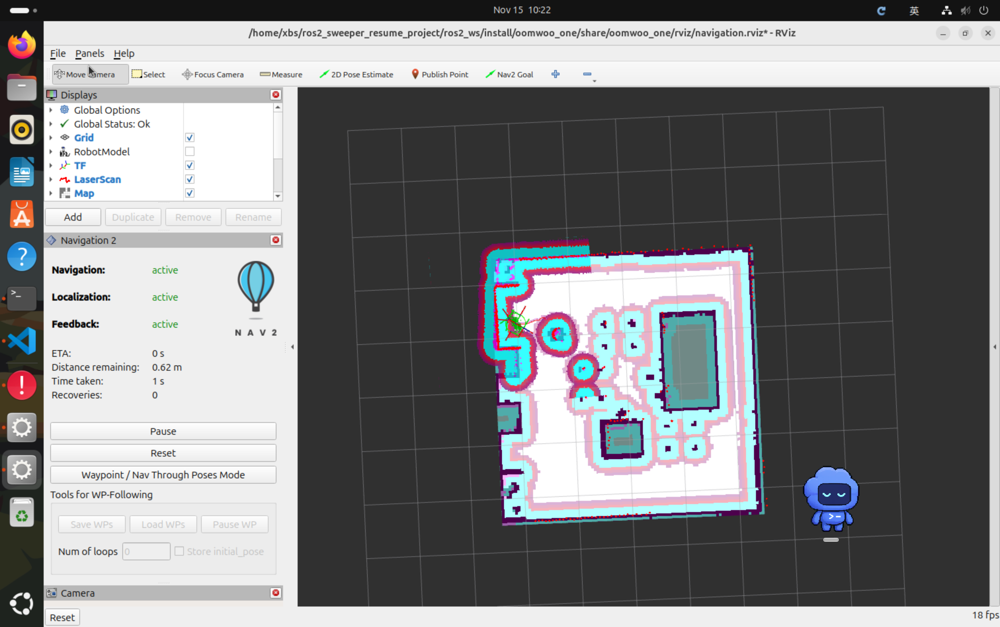

# ROS 2 自主清扫机器人


> 这是我为机器人软件开发岗位准备的简历项目。目标不只是让机器人“能动”，而是让它能够自主生成清扫路线、执行清扫任务、识别漏扫区域，并在导航失败或遇到障碍时继续完成任务。

## 演示


上图包含 Gazebo 客厅、RViz 机器人模型、整屋覆盖结果和跨地图验收结果。

### RViz2 导航与地图可视化



RViz2 用于同时观察栅格地图、机器人模型、TF、激光雷达、AMCL 定位、Nav2 全局与局部代价地图以及导航状态。清扫系统还可以叠加显示覆盖规划路径、当前目标和已清扫区域，便于分析机器人为什么选择某条路线以及障碍物如何影响导航。

项目提供专用的 `cleaning.rviz` 配置。使用 `rviz:=true` 启动时会自动加载清扫路径、当前目标和运行时覆盖网格；Gazebo 真值覆盖图层默认关闭，需要独立验收时可在 RViz 的 `Cleaning` 分组中开启。

## 项目实现的功能

- 根据栅格地图自动生成覆盖清扫路线。
- 通过 Nav2 `NavigateToPose` Action 执行清扫航点。
- 根据 TF 位姿更新已清扫区域，识别漏扫并动态补扫。
- 支持任务暂停、恢复、取消和检查点续扫。
- 处理导航失败、超时、Nav2 退出和动态障碍。
- 对导航、手动控制、恢复和急停速度指令进行安全仲裁。
- 使用 Gazebo 真值轨迹独立统计覆盖率、实际里程和路径效率。
- 统一管理机器人半径、轮径、轮距、清扫半径和关键坐标系。
- 监控 AMCL 协方差与 TF 健康状态，定位异常时暂停任务和覆盖统计。
- 发布结构化清扫事件，并支持按任务和事件代码查询历史记录。

## 核心开发内容

项目围绕室内移动机器人自主清扫场景完成了从仿真、导航到任务管理和工程验收的完整链路：

1. 使用 C++17 和 ROS 2 Action 实现清扫任务管理器。
2. 实现覆盖路径规划、漏扫识别和动态补扫。
3. 用 `enum class` 重构任务状态机，统一管理状态转换。
4. 处理任务取消与导航结果竞争、旧任务回调延迟到达等异步问题。
5. 实现速度指令仲裁、急停、碰撞停车和心跳看门狗。
6. 建立统一机器人几何配置，并验证 URDF、Gazebo、Nav2 和清扫模块的一致性。
7. 实现定位健康监控、定位异常暂停以及稳定恢复后的安全续扫。
8. 实现结构化任务事件日志，记录状态转换、规划、导航、恢复和任务结果。
9. 搭建 Gazebo 自动化测试，并增加简单弓字形 baseline 进行算法对照。

## 项目架构


```text
AMCL / TF -> LocalizationHealthMonitor
                    |              |
                    v              v
CleanTask Action -> CleaningTaskManager -> Coverage Planner
                         |
                         v
                 NavigationExecutor -> Nav2 -> Motion Safety -> Gazebo Robot
                         |
                         v
               CleaningEvent Topic / 查询服务
```

- `CleaningTaskManager`：任务的统一协调入口。
- `Coverage Planner`：生成初始清扫路线和补扫路线。
- `NavigationExecutor`：向 Nav2 发送航点并处理导航结果。
- `LocalizationHealthMonitor`：根据 AMCL 协方差、TF 和数据新鲜度判断定位状态。
- `Motion Safety`：管理速度指令优先级和安全停车。
- `CleaningEvent`：记录可查询的任务生命周期和异常恢复事件。
- Gazebo 真值只用于验收，不参与机器人运行时决策。

## 面试中可以重点介绍的内容

### 1. ROS 2 Action 与任务状态机

清扫任务执行时间长，需要持续反馈进度，还需要支持取消，因此使用 Action 而不是 Service。状态机负责约束 `PLANNING`、`RUNNING`、`PAUSED`、`RECOVERING` 等状态之间的转换。

为了防止旧任务的导航或规划回调改变新任务，系统对任务和导航请求都进行代次校验。

### 2. 覆盖规划与动态补扫

初始路线根据地图可达区域、机器人净空和清扫宽度生成。任务执行过程中，系统根据 TF 位姿更新覆盖网格，将剩余漏扫区域聚合，再结合可达性、覆盖收益和行驶代价生成补扫路线。

### 3. 定位异常为什么必须暂停覆盖统计

如果定位发生跳变，继续更新覆盖网格会把机器人没有经过的区域错误标记为已清扫。定位监控器通过 AMCL XY 协方差、`map -> base_footprint` TF 和运动时的数据新鲜度判断健康状态。

定位丢失后，系统取消当前 Nav2 目标、停止恢复速度、保存检查点并冻结覆盖率和里程；只有定位稳定恢复、Nav2 可用且急停解除后，定位监控触发的暂停才会自动续扫。人工暂停不会被自动恢复。

### 4. 怎么证明算法有效

项目不使用规划路线代替真实执行轨迹，而是使用 Gazebo 真值位姿独立计算覆盖率和行驶里程。同时实现了一套独立的简单弓字形 baseline，使用相同地图、Nav2 参数和验收方式与当前算法对比。

## 仿真结果

### 代码与回归测试

- 7 个相关 ROS 2 包构建成功。
- `260 tests, 0 errors, 0 failures, 11 skipped`。
- 已验证暂停恢复、取消、检查点续扫、导航失败、Nav2 退出和动态障碍恢复。
- 定位丢失后，覆盖率和执行里程保持冻结；稳定恢复后仅自动恢复定位触发的暂停。
- 导航异常测试中，Nav2 关闭后约 `0.375 s` 内速度归零，清扫 Action 正确返回失败原因。
- 结构化事件查询验证了任务 ID 过滤、事件代码过滤、容量淘汰和最新事件优先顺序。

### 优化算法与 baseline

| 五张地图平均 | 当前算法 | baseline |
|---|---:|---:|
| Gazebo 真值覆盖率 | 91.68% | 91.20% |
| 实际行驶里程 | 15.55 m | 20.09 m |
| 到达 90% 覆盖的里程 | 14.49 m | 17.96 m |
| 路径效率 | 74.51% | 56.61% |
| 重复行驶率 | 25.63% | 39.55% |

- 10/10 轮 Action 执行成功，10/10 轮 Gazebo 真值覆盖率达到 90%。
- 当前算法平均少行驶 4.54 m，路径效率提高 17.90 个百分点。
- L 形地图中 baseline 反而少行驶 0.60 m，说明跨区域顺序仍有优化空间。

动态障碍测试中，障碍物位姿更新 62 次，发生 1 次导航失败并恢复，最终 Action 成功，Gazebo 真值覆盖率为 91.54%。

最新专项回归再次记录了 62 次动态障碍更新、2 次碰撞恢复和 1 次导航失败，任务最终成功。该轮执行的是分区清扫，因此运行时分区覆盖率不能与整图真值覆盖率直接比较。

[查看完整 baseline 对照数据](results/refactor-baseline-20261113/experiments/comparison.md)

## 技术栈

- C++17、Python 3、CMake、colcon、GTest
- ROS 2 Jazzy、`rclcpp`、Action、Service、Topic、TF2、Lifecycle
- Nav2、AMCL、SLAM Toolbox、costmap
- Gazebo Harmonic、`ros_gz_bridge`
- Reliable / Transient Local QoS、结构化事件接口、异步回调代次保护
- 栅格地图、弓字形覆盖、Wavefront 连接、可达性检查

## 运行项目

```bash
cd /home/xbs/ros2_sweeper_resume_project/ros2_ws
source /opt/ros/jazzy/setup.bash
colcon build --symlink-install --parallel-workers 3
source install/setup.bash

cd ..
python3 scripts/run_cleaning_benchmark.py \
  --scenario multi_room \
  --runs 1 \
  --whole-map \
  --gui \
  --coverage-algorithm optimized \
  --output results/readme-demo
```

## 项目边界

- 目前只完成 Gazebo 仿真，没有实体机器人测试证据。
- baseline 对照为每种算法、每张地图一轮有效仿真，不代表统计显著性结论。
- 窄通道的重复行驶仍偏高，L 形房间的跨区域顺序仍可优化。
- 定位健康判断目前基于 AMCL 协方差、TF 和数据新鲜度，尚未加入多传感器一致性诊断。
- 虚拟机 CPU 高负载时，Nav2 Lifecycle 启动仍可能偶发失败，需要继续完善启动健康检查。

## 关键配置与接口

- 机器人几何唯一配置：`robot_geometry.yaml`
- 清扫任务 Action：`robot_cleaning_interfaces/action/CleanTask`
- 定位健康消息：`robot_cleaning_interfaces/msg/LocalizationHealth`
- 清扫事件消息与查询：`CleaningEvent.msg`、`ListCleaningEvents.srv`

## 详细文档

- [任务管理器重构与 baseline 设计](docs/refactor_and_baseline.md)
- [完整验收报告](results/refactor-baseline-20261113/report.md)
- [优化算法与 baseline 逐场景数据](results/refactor-baseline-20261113/experiments/comparison.md)
