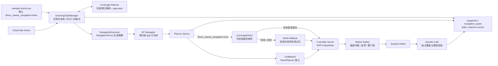

# Coverage Planner 与 Nav2 系统架构

本文描述最终默认配置和可选实验配置的调用边界。默认全局规划器是 Navfn；
CoverageDirectPlanner 只作为显式开关启用的主清扫实验插件。

## 默认与实验路径

- 默认启动时，所有清扫和 gap 目标都使用 `GridBased`，其插件为
  `nav2_navfn_planner::NavfnPlanner`。
- `direct_sweep_navigation:=true` 时，启动文件追加 `CoverageDirect` 插件，并仅为
  主清扫 pass 生成 `planner_id=CoverageDirect` 的行为树。
- CoverageDirectPlanner 继承 Navfn，只有短距离直连同时通过中心 cost 和完整 footprint
  检查时才返回直线；距离、costmap、footprint 或取消检查失败时回退 Navfn。
- gap 导航保持 Navfn，以免把补扫连接和跨区域通道的安全策略混入直连 A/B 变量。
- Controller Server 仍由 RPP 跟踪 Nav2 全局路径；CoverageDirectPlanner 不是控制器，也不替换
  `NavigateToPose` 或现有恢复行为树。

## 观测数据边界

Coverage Planner 航点、Nav2 `/plan` 和 Gazebo 真值记录统一在 `map` 坐标系中分析；TF
残差通过对应仿真时间戳查询 `map <- base_footprint`。Gazebo `world` 不直接与 ROS `map`
坐标相减。`/plan` 的重新规划消息用于解释路径选择和恢复，不用于累加真实行驶里程；实际里程、
90% 覆盖里程和重复率使用 Gazebo 真值轨迹计算。

规划器决策统计来自 `CoverageDirectPlanner::createPlan()` 的实际分支，包括请求、直线尝试、
命中、各类拒绝和 Navfn 回退；不使用发布路径是否共线来猜测命中。
